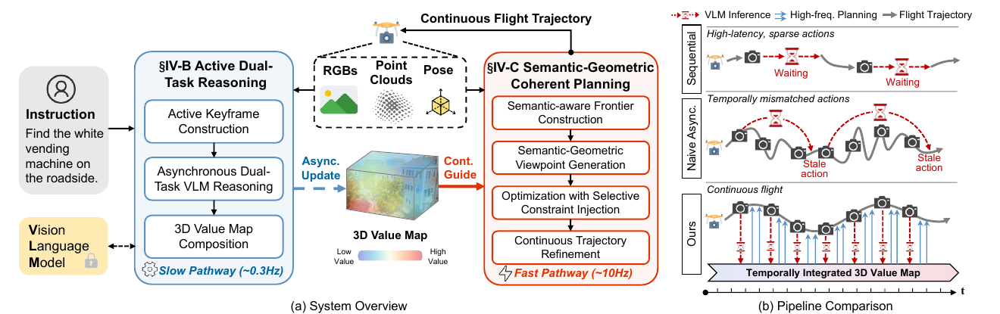

<div align="center">

# AirHunt: Bridging VLM Semantics and Continuous Planning for Efficient Aerial Object Navigation

<p><strong>IEEE Robotics and Automation Letters (RA-L), 2026</strong></p>

<p>
  <a href="https://github.com/Goolo2">Xuecheng Chen</a><sup>1</sup>,
  Zongzhuo Liu<sup>2</sup>,
  Jianfa Ma<sup>3</sup>,
  Bang Du<sup>4</sup>,
  Tiantian Zhang<sup>1</sup>,
  <a href="https://scholar.google.com/citations?user=h9dN_ykAAAAJ&hl=zh-CN">Xueqian Wang</a><sup>1,&dagger;</sup>,
  <a href="https://robotics-star.com/people">Boyu Zhou</a><sup>2,5,&dagger;</sup>
</p>

<p>
  <sup>1</sup> Shenzhen International Graduate School, Tsinghua University, Shenzhen, China<br>
  <sup>2</sup> Department of Mechanical and Energy Engineering, Southern University of Science and Technology, Shenzhen, China<br>
  <sup>3</sup> Department of Computer Science and Engineering, Southern University of Science and Technology, Shenzhen, China<br>
  <sup>4</sup> Department of Physics, Southern University of Science and Technology, Shenzhen, China<br>
  <sup>5</sup> Differential Robotics
</p>

<p>
  <sup>&dagger;</sup> Corresponding Authors<br>
</p>

<p>
  <a href="https://doi.org/10.1109/LRA.2026.3730212"></a>
  <a href="https://www.bilibili.com/video/BV1nUmgB7Eag/"></a>
</p>

</div>

## Introduction

AirHunt is an aerial object navigation system that locates open-set objects in outdoor environments from natural-language instructions. It addresses the frequency mismatch between VLM inference and real-time planning, limited 3D scene understanding, and the challenge of balancing semantic guidance with motion efficiency. A dual-pathway asynchronous architecture connects active visual reasoning with continuous planning through a persistent 3D value map, enabling efficient search and continuous flight with zero-shot generalization.

<p align="center">
  
</p>

## Installation

### 1. Prerequisites

The current runtime has been tested on **Ubuntu 24.04, Python 3.11, ROS Noetic through RoboStack, and PyTorch 2.7.1 with CUDA 12.8**. An NVIDIA GPU with a compatible driver and Vulkan support is required to render the simulator and run the perception models.

Install [micromamba](https://mamba.readthedocs.io/en/latest/installation/micromamba-installation.html), then clone the repository and create the environment:

```bash
git clone https://github.com/Robotics-STAR-Lab/AirHunt.git
cd AirHunt
micromamba create -p "$PWD/.runtime" -f environment.yml
```

### 2. Runtime Configuration

Create the local configuration file:

```bash
test -f .env || cp .env.example .env
```

Edit `.env` and use absolute paths:

| Variable | Description |
| --- | --- |
| `AIRHUNT_RUNTIME` | Environment created above, e.g. `/absolute/path/to/AirHunt/.runtime` |
| `MICROMAMBA` | `micromamba` on `PATH`, or its absolute executable path |
| `AIRHUNT_ENV_EXECUTABLE` | Full path to `CabinLake-Linux-Shipping` inside the extracted scene |
| `AIRHUNT_CHECKPOINTS` | Directory containing the two model checkpoints listed below |
| `HF_HOME` | Hugging Face cache directory for CLIP and BERT |
| `DASHSCOPE_API_KEY` | API key for the Qwen vision-language model |
| `DASHSCOPE_BASE_URL` | OpenAI-compatible endpoint associated with the API key |
| `DASHSCOPE_MODEL` | Vision-language model name; the example uses `qwen3-vl-plus` |

Keep `.env` local. The launcher reads it automatically.

### 3. Python Dependencies

Install the CUDA 12.8 PyTorch build and the remaining dependencies:

```bash
./scripts/env.sh python -m pip install torch==2.7.1 torchvision==0.22.1 \
  --index-url https://download.pytorch.org/whl/cu128
./scripts/env.sh python -m pip install -r requirements.txt
./scripts/env.sh python -m pip install --no-deps airsim==1.8.1 msgpack-rpc-python==0.4.1
./scripts/env.sh python scripts/patch-rpc.py
```

The environment manifest includes the ROS and C++ build dependencies. Each command uses the environment configured in `.env`.

## Simulation Environment and Model Weights

### AirSim Environment

Download [**CabinLake.zip**](https://huggingface.co/datasets/Kyaren/UAV-ON-envs-train/resolve/main/CabinLake.zip?download=true) from the [UAV-ON training environments](https://huggingface.co/datasets/Kyaren/UAV-ON-envs-train/tree/main) and extract it locally. Retain the entire scene directory, including its packaged content and binaries. Set `AIRHUNT_ENV_EXECUTABLE` in `.env` to the absolute path of `CabinLake/Binaries/Linux/CabinLake-Linux-Shipping` inside the extracted archive. Scene assets are external to this repository.

The launcher supplies [the AirSim settings](configs/airsim.json) and starts the packaged environment automatically.

### Model Weights

Download the following checkpoints from their official projects and place both files in `AIRHUNT_CHECKPOINTS`:

| Model | Checkpoint | Download |
| --- | --- | --- |
| SAM 2.1 Large | `sam2.1_hiera_large.pt` | [SAM 2](https://github.com/facebookresearch/sam2#download-checkpoints) |
| Grounding DINO Swin-T | `groundingdino_swint_ogc.pth` | [Grounding DINO](https://github.com/IDEA-Research/GroundingDINO#install) |

CLIP (`ViT-B-32`, `laion2b_s34b_b79k`) and BERT (`bert-base-uncased`) are downloaded to the Hugging Face cache on first use. Ensure that the Qwen endpoint supports image inputs and that the configured model is available to your API key.

## Usage

From the repository root, build and run the CabinLake umbrella navigation example:

```bash
./scripts/build.sh
./scripts/run-example.sh --timeout 180
```

Videos, trajectories and logs are saved to `outputs/navigation-<timestamp>/`.

### Code Structure

```text
configs/                      Camera, perception and navigation settings
examples/cabinlake_umbrella/   Example episode and launcher
perception/airhunt/            Perception, object memory, VLM reasoning and recording
ros_ws/src/                   Mapping, SOP planning, trajectories and AirSim bridge
scripts/                      Environment, build and run commands
third_party/                  Model inference code and SOP solver
```

Perception parameters are in [configs/perception.yaml](configs/perception.yaml). The ROS entry point is [configs/navigation.launch](configs/navigation.launch), and the SOP threshold `rho=0.15` is configured in [airsim_algorithm.xml](ros_ws/src/exploration_manager/launch/airsim_algorithm.xml).

## Acknowledgment

We thank the authors and maintainers of the following open-source projects:

- [FUEL](https://github.com/HKUST-Aerial-Robotics/FUEL) and [Fast-Planner](https://github.com/HKUST-Aerial-Robotics/Fast-Planner) for frontier exploration, mapping and trajectory planning.
- [SOP](https://github.com/rod409/SOP) for the sequential ordering solver used in frontier visit planning.
- [3D-Mem](https://github.com/UMass-Embodied-AGI/3D-Mem) and [ConceptGraphs](https://github.com/concept-graphs/concept-graphs) for object-centric scene memory and mapping components.
- [Grounding DINO](https://github.com/IDEA-Research/GroundingDINO) and [SAM 2](https://github.com/facebookresearch/sam2) for open-vocabulary detection and segmentation.
- [OpenCLIP](https://github.com/mlfoundations/open_clip) for visual features and [Qwen](https://github.com/QwenLM/Qwen3-VL) for vision-language reasoning.
- [AirSim](https://github.com/microsoft/AirSim) and [OpenFly-Platform](https://github.com/SHAILAB-IPEC/OpenFly-Platform) for aerial simulation resources.

Source versions are recorded in [UPSTREAM.json](UPSTREAM.json).

## Citation

If you find AirHunt useful in your research, please cite:

```bibtex
@article{chen2026airhunt,
  author  = {Chen, Xuecheng and Liu, Zongzhuo and Ma, Jianfa and Du, Bang and Zhang, Tiantian and Wang, Xueqian and Zhou, Boyu},
  title   = {{AirHunt}: Bridging {VLM} Semantics and Continuous Planning for Efficient Aerial Object Navigation},
  journal = {IEEE Robotics and Automation Letters},
  year    = {2026},
  volume  = {11},
  number  = {11},
  pages   = {12495--12502},
  doi     = {10.1109/LRA.2026.3730212}
}
```
